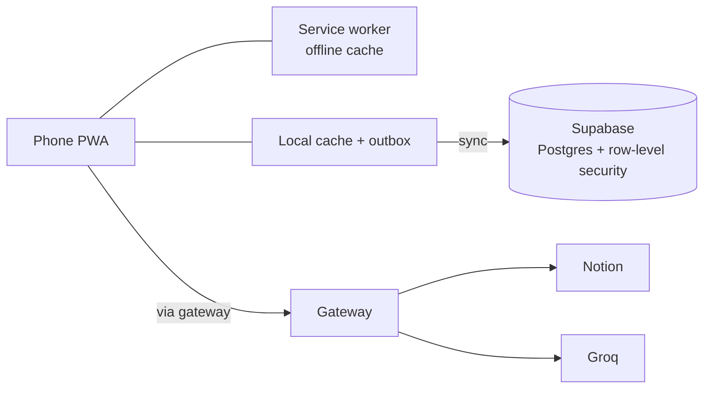

# Naked Brain

[](https://github.com/Nkdfarm/naked-brain/actions/workflows/check.yml)

The phone app for the people working on the floor of a FarmBox: the day's tasks, checklists and SOPs, scouting
photos, harvest, voice notes. It works offline and syncs when the phone has a signal.

**Live: https://brain.nkd.farm/** · User guide: [`guide.html`](guide.html)

On a phone, open the address and use *Add to Home Screen* (iPhone) or *Install app* (Android/Chrome).

Naked Brain is one of the two apps of the **FarmBox Operations Platform**. The other one is **Naked Heart**, the
desktop console for managers (https://heart.nkd.farm/). Both apps share one database on Supabase. The database,
its rules and the decision log are in the private repository `Nkdfarm/FarmBox-Platform`.

## Features

- Today's tasks, checklists and standard operating procedures (SOPs) for each crew member
- Scouting photos with an AI reading that a person confirms
- Harvest capture and voice notes
- Works offline: a local cache and an outbox keep the crew working without signal and sync later
- Installable on iPhone and Android, with an in-app update prompt

## Architecture



## What this repository is

Static files. The only step is `python build.py`, which joins `src/` into `index.html` (Python 3, nothing to install):

| File | What |
|---|---|
| `index.html` | The whole app as the phone gets it: one file. **Built** from `src/` by `python build.py` — never edit it by hand |
| `src/` | The source of `index.html` in pieces: `css/`, `html/`, `js/app` (icons, update check, version log, password gate), `js/capture` (Capture, Notion notes), `js/shared` (rules shared with Naked Heart, generated from FarmBox-Platform `shared/`: never edit here), `js/sop` (what is left of the Notion procedures: their old outbox), `js/cloud` (Tasks on Supabase: session, sync and outbox, tasks, runs, Digital scouting, gallery). `src/index.manifest` gives the order |
| `build.py` | Puts `src/` together into `index.html`; `--check` says whether they agree (GitHub runs it on every push) |
| `tools/check_syntax.py` | Parses every script of `index.html` with Node |
| `sw.js` | Service worker: offline cache |
| `manifest.json`, `icon-*.png`, `apple-touch-icon.png`, `splash/` | Install as an app |
| `version.json` | The version a phone checks to offer "Update now" |
| `skins/` | Colour themes as JSON tokens (Settings › Appearance › Skin) |
| `guide.html` | The user guide |
| `cloudflare-worker.js` | A copy of the Cloudflare Worker that passes calls to Notion and Groq behind the team password |
| `serve.ps1` | Serves the folder on http://localhost:3000 for testing |
| `transcribe.ps1` | Turns a video or audio file into text with Groq Whisper |

Libraries are loaded from jsDelivr at exact versions (pdf.js, mammoth, Tesseract.js, jsQR, MediaPipe and others).

## Run it locally

```powershell
.\serve.ps1
```

You can also run `python -m http.server 3000` in this folder and open http://localhost:3000.

## Changing it

1. Edit the piece in `src/` (each file's first line says what it holds; `js/cloud/*` and `js/sop/*` are parts of one
   function each, so a name defined in one piece is seen by the others of the same group).
2. `python build.py` — writes `index.html`.
3. `python build.py --check` and `python tools/check_syntax.py` — GitHub runs both, and the version check, on every push.
4. Open the page (`.\serve.ps1`) and read the browser console before committing `src/` and `index.html` together.

## Releasing

GitHub Pages serves the branch **`live`**, not `main`: **a push to `main` publishes nothing.** A release is
made only with the owner's script `scripts/release-brain.ps1` in FarmBox-Platform (the `release-brain` skill).
It bumps the version in the places that move together, adds the row to `VERSION_LOG` in `src/js/app/version-log.js`, and
moves `live`. Never push `live` by hand.

## Security

See [SECURITY.md](SECURITY.md) to report a problem privately.

## Licence

Copyright © 2026 Naked Farms. All rights reserved. See [LICENSE](LICENSE).

## History

Formerly published under a different account name; the old address now redirects people to https://brain.nkd.farm/.
